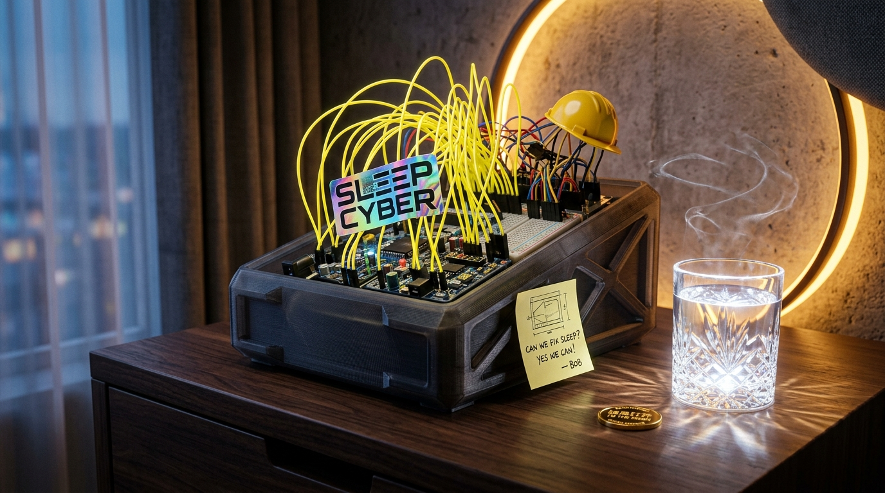
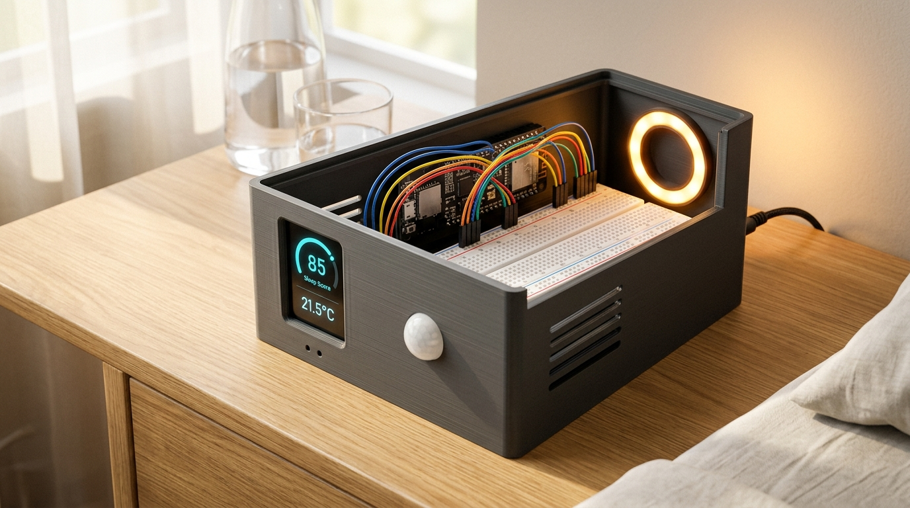
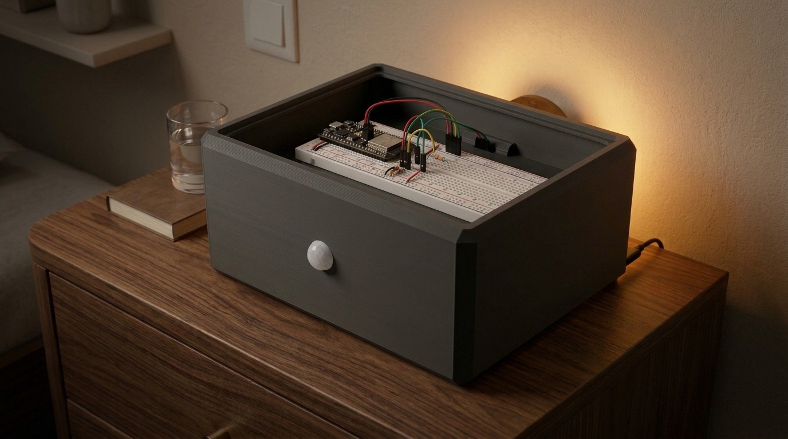

# 🌙 Project Wake · Ambient Sleep Hygiene & Bedroom Environment Monitor

<p align="center">
  <a href="README_EN.md"><b>English</b></a> | <a href="README.md"><b>简体中文</b></a>
</p>

> **Project Wake: Dedicated Bedroom Micro-Environment Guardian**  
> Developers: **Hangcheng Liu & Xia Gong (刘航成 & 夏工)**  
> Hardware Platform: **ESP32-S3-Korvo-2 V3 (KSDIY Edition)**  
> Target Scenarios: Hackathon Innovation / Ambient Sleep Hygiene / Zero-Screen IoT Node / Web Bluetooth Dashboard / Edge Voice VAD

[](https://www.espressif.com/)
[](https://developer.mozilla.org/en-US/docs/Web/API/Web_Bluetooth_API)
[](https://github.com/arduino/arduino-cli)
[](3d_models/)
[](LICENSE)

---

## 🏆 Hackathon Delivery Overview

Project Wake has achieved **full-stack, closed-loop delivery** during the hackathon: from parametric 3D enclosure modeling, ESP32-S3 dual-core firmware engineering, edge-native lightweight adaptive VAD (Voice Activity Detection), to a local LLM voice relay hub and a cross-platform Web Bluetooth dashboard. The entire pipeline has been fully implemented and verified on real hardware.

```
                              Wake System Architecture & Topology
  ┌─────────────────────────────────────────────────────────────────────────────┐
  │                               Physical Hardware                             │
  │  [ESP32-S3 Korvo 2 V3] ── Dual Mic ES7210 ── ES8311 DAC + 3W Cavity Speaker │
  │  ├── 1.69" ST7789 IPS Touch LCD (TCA9554A Hardware Backlight Cutoff = 0 Lux) │
  │  ├── WS2812 8-RGB Ring (High-precision RMT Driver / Amber Nightlight / FX)  │
  │  ├── I2C Sensor Bus: BH1750 (Ambient Light 0.1-65535 lx) + SPA06 (P / T)    │
  │  └── GPIO Peripherals: AM412 PIR Motion Sensor + 6-Key ADC Divider Matrix   │
  └────────────────────────┬─────────────────────────────┬──────────────────────┘
                           │ BLE 5.0 GATT (5Hz)          │ Wi-Fi 802.11 b/g/n
                           ▼                             ▼
  ┌──────────────────────────────────┐        ┌─────────────────────────────────┐
  │     Web Bluetooth Dashboard      │        │       Local Voice Relay Hub     │
  │      (ble_dashboard.html)        │        │      (voice_relay/server.py)    │
  │  • Driverless Web BLE Link       │        │  • Adaptive Noise Floor VAD     │
  │  • Real-time Waveforms & Sim     │        │  • Whisper ASR + Char Mapping   │
  │  • WS2812 Ring Color Visualizer  │        │  • LLM Intent (Night/Dream/Q&A) │
  │  • Over-the-Air Wi-Fi Provision  │        │  • TTS Audio + 60s Auto Breaker │
  │  • Apple Watch Dual-Track Align  │        │  • Offline Voice Fallback Mode  │
  └──────────────────────────────────┘        └─────────────────────────────────┘
```

---

## Table of Contents
1. [Product Vision & Core Philosophy](#1-product-vision--core-philosophy)
2. [Hardware Architecture & Key Specifications](#2-hardware-architecture--key-specifications)
3. [Industrial Design & 3D Printable Enclosures](#3-industrial-design--3d-printable-enclosures)
4. [Pinout & Peripheral Mapping](#4-pinout--peripheral-mapping)
5. [Flash Layout & Non-Destructive Dual-OTA Design](#5-flash-layout--non-destructive-dual-ota-design)
6. [Dual-Mode Voice Engine: Edge VAD & Cloud Relay](#6-dual-mode-voice-engine-edge-vad--cloud-relay)
7. [WS2812 8-LED Ring Control & RMT Engine](#7-ws2812-8-led-ring-control--rmt-engine)
8. [BLE GATT Communication Protocol](#8-ble-gatt-communication-protocol)
9. [External Sensor Wiring Guide](#9-external-sensor-wiring-guide)
10. [Web Bluetooth Dashboard Architecture](#10-web-bluetooth-dashboard-architecture)
11. [Toolchain, Compilation & Flashing Guide](#11-toolchain-compilation--flashing-guide)
12. [3-Minute Hackathon Pitch Script & Deck Automation](#12-3-minute-hackathon-pitch-script--deck-automation)

---

## 1. Product Vision & Core Philosophy

### The Real Problem: We Measure the Sleeper, Not the Room
- **The Blind Spot of Wearables**: Devices like Apple Watch, Whoop, and Oura Ring excel at tracking **human physiological signals** (heart rate, HRV, body movement, sleep stages). However, they have **zero perception of the bedroom environment**.
- **Medical Consensus**: The vast majority of sleep disruptions, shallow sleep, and middle-of-the-night arousals stem directly from **poor sleep hygiene**—transient noise spikes, midnight temperature drift, early-morning light leaks, and harsh lighting during bathroom visits.
- **Wake's Value Proposition**: A bedside ambient sentinel designed specifically for the bedroom micro-climate.
  - **Measure the Room, Not the Person**: We do not compete with wearables for physiological diagnosis; we provide the missing environmental context to form causal explanations.
  - **Zero Light Pollution**: Physical screen backlight cut-off during sleep mode (**true 0.00 Lux darkness**). No phones on the nightstand, no screen glare.
  - **One-Sentence Morning Debrief**: Upon waking, Wake gives you a concise spoken diagnosis of last night's biggest culprit (*"At 03:15, a 64dB traffic spike caused your early arousal—keep windows closed tonight"*).
  - **Zero Camera, Absolute Privacy**: Standard visible cameras are completely blind in dark bedrooms (<1 Lux), generate thermal distortion affecting sensors, and trigger acute privacy anxiety. Wake substitutes vision entirely with multi-sensor state fusion.

<p align="center">
  
</p>

---

## 2. Hardware Architecture & Key Specifications

| Subsystem | Component / IC | Key Specifications |
| :--- | :--- | :--- |
| **MCU** | ESP32-S3 (QFN56, Revision v0.2) | Dual-core Xtensa LX7 @ 240MHz with AI vector instructions |
| **Memory** | ESP32-S3-WROOM-1-N16R8 | **16MB QIO SPI Flash** + **8MB Octal SPI PSRAM (AP_3v3)** |
| **Display** | ST7789 IPS LCD (1.69") | Resolution **240 × 280** (X_GAP=20), SPI @ 40MHz, 180° inverted |
| **Touch** | Hynitron CST816S | Capacitive multi-point touch controller, I2C address `0x15` |
| **Audio DAC** | Everest ES8311 + NS4150B PA | 16kHz/44.1kHz 16-bit I2S, driving 3W cavity speaker |
| **Audio ADC** | Everest ES7210 4-ch Mic ADC | Dual MSM381A3729H9CP analog mics, I2C address `0x40` |
| **Ambient Light**| WS2812B 8-LED Ring | GPIO 20 driven by hardware RMT, nanosecond precision |
| **IO Expander** | TCA9554A 8-bit I2C GPIO | Address `0x38`; Bit 1 cuts LCD backlight; Bit 0 controls peripheral power |
| **Key Matrix** | 6-Key Resistor Divider (GPIO 5) | Single 12-bit ADC pin distinguishes keys K1 through K6 |
| **Connectivity** | 2.4GHz Wi-Fi + Bluetooth 5 (LE) | BLE GATT peripheral running at 4~5Hz telemetry stream |

---

## 3. Industrial Design & 3D Printable Enclosures

In the [`3d_models/`](3d_models/) directory, Project Wake provides complete parametric OpenSCAD modeling files, watertight manifold STL print slice files, and high-fidelity concept renders.

| Enclosure Variant | Target Scenario | Key Features & Source Assets |
| :--- | :--- | :--- |
| **Form B Classic Windowed**<br>*(Recommended Print)* | Bedside nightstand, formal demo day presentation | Dimensions: 165 × 55 mm. Features custom bezels for 1.69" LCD, acoustic cutouts for dual mics and speaker, side Type-C cable path.<br>• Print STL: [`wake_box_form_b_165x55.stl`](3d_models/wake_box_form_b_165x55.stl)<br>• OpenSCAD: [`wake_box_form_b_165x55.scad`](3d_models/wake_box_form_b_165x55.scad) |
| **Form B Screenless Minimalist** | Extreme zero-light purists | Solid top surface with no screen reflection. Uses top WS2812 ring amber illumination and offline voice debrief.<br>• Print STL: [`wake_box_final_screenless.stl`](3d_models/wake_box_final_screenless.stl) |
| **Form A Angled Caddy** | Desktop workspace or nightstand view | Ergonomic 30° viewing tilt angle for effortless touchscreen operation.<br>• OpenSCAD: [`wake_box_angled.scad`](3d_models/wake_box_angled.scad) |
| **MVP Open Box** | Rapid debugging and testing | Fast print (~1.5 hours) with open-access sensor pin headers.<br>• Print STL: [`wake_box_mvp_open.stl`](3d_models/wake_box_mvp_open.stl) |

<p align="center">
  
  
</p>

> [!TIP]
> Recommended slicing parameters: **PLA+ or PETG (Matte Black / Charcoal Grey)**, `0.2mm` layer height, `15%~20%` infill, `3 wall perimeters`. See [`3d_models/README.md`](3d_models/README.md) for complete details.

---

## 4. Pinout & Peripheral Mapping

```
              ESP32-S3-Korvo-2 V3 Core Pinout
┌───────────────────────────────────────────────────────────────┐
│ [ST7789 LCD]       MOSI: 0  | SCLK: 1  | DC: 2   | CS: 46     │
│ [I2S Audio Stream] MCLK: 16 | BCLK: 9  | WS: 45  | DOUT: 8 (DAC)│
│                    DIN: 10 (ADC Mics)  | PA Enable: 48        │
│ [Shared I2C Bus]   SDA: 17  | SCL: 18  (@ 400kHz)              │
│                    • 0x15: CST816S Capacitive Touch           │
│                    • 0x18: ES8311 Playback DAC                │
│                    • 0x38: TCA9554A IO Expander (P1=Backlight)│
│                    • 0x40: ES7210 Mic ADC (+30dB Mic Gain)    │
│                    • 0x23: BH1750 Ambient Light Sensor        │
│                    • 0x76: SPA06 Barometer & Thermometer      │
│ [WS2812 LED Ring]  GPIO 20 (RMT Hardware Channel)             │
│ [PIR Motion Sensor]GPIO 19 (Active HIGH)                      │
│ [6-Key ADC Matrix] GPIO 5 (ADC1 Channel 4)                    │
└───────────────────────────────────────────────────────────────┘
```

---

## 5. Flash Layout & Non-Destructive Dual-OTA Design

To safeguard the factory-flashed Xiaozhi AI firmware without damaging its proprietary wake-word models, Wake uses a **non-destructive, OTA1-isolated flashing strategy**:

```
Flash Physical Address Map (16MB Total):
0x000000 ─────────── Bootloader bootloader.bin (32KB)
0x008000 ─────────── Partition Table partition-table.bin (4KB)
0x00e000 ─────────── OTA Data otadata.bin (8KB) [Backed up as backup_otadata.bin]
0x010000 ─────────── Factory 3MB Offline Wake Model (model) [Untouched]
0x330000 ─────────── ota_0 (4MB): Original Factory Xiaozhi AI Firmware [Preserved]
0x730000 ─────────── ota_1 (4MB): Project Wake Firmware [Active App]
```

- **Current Active Slot**: Booted to `ota_1` via `otadata_ota1.bin`.
- **Target Flash Offset**: **Always flash to `0x730000`**. Never erase `0x330000` or `0x010000`.
- **Restore Factory Firmware**:
  ```bash
  esptool --chip esp32s3 --port /dev/cu.usbmodem5B790674601 write-flash 0x00e000 backup_otadata.bin
  ```

---

## 6. Dual-Mode Voice Engine: Edge VAD & Cloud Relay

Wake features a dual-mode voice engine: an **onboard offline speech synthesizer** that operates without network access, and a **local cloud-assisted Voice Relay** for interactive LLM conversation and control.

### 1. Edge-Native Lightweight VAD (`display_name/speech_detect.h`)
A pure C++ Voice Activity Detection state machine built for embedded low-compute environments:
- **Adaptive Ambient Noise Tracking**: Evaluates baseline room noise upon boot (1s warm-up) and tracks slowly rising environmental background noise (capped at 4000 RMS).
- **Transient Pulse Filtering**: Requires 3 consecutive high-energy frames (48ms) to trigger speech detection, eliminating door slams or table bumps.
- **Pre-Roll Audio Ring Buffer**: Maintains a 14-frame (~224ms) pre-roll buffer so the initial syllable of "Xiao Ye" is never clipped.
- **Hangover Silence & Overflow Guard**: Automatically detects sentence completion after 44 quiet frames (~700ms); caps recording at 24s to prevent buffer overflow.
- **Unit Tested**: Fully tested against 11 acoustic test vectors in `tools/test_speech_detect.cpp`.

### 2. Local Voice Relay Hub (`voice_relay/server.py`)
Built with Python standard libraries (zero third-party dependencies):
- **Wake Word Gate**: Filters incoming audio for "Xiao Ye" with sliding follow-up conversation windows.
- **Anti-Interception & Exponential Retry**: Emulates browser User-Agent headers to avoid Cloudflare 1010 blocks; catches remote disconnections with 1.5s/3.0s exponential backoff retries.
- **Circuit Breaker for TTS**: Automatically triggers a 60-second circuit breaker after 2 consecutive TTS failures, falling back to instant command execution and onboard voice confirmation.
- **Traditional-to-Simplified Mapping & Hallucination Filter**: Maps homophones and filters out Whisper silent-audio subtitle hallucinations.
- **Intent Recognition & Dream Journal**: Direct command execution (`Start Night` $\rightarrow$ `N:1`, `Stop Night` $\rightarrow$ `N:2`), plus automatic recording of dream descriptions to local `notes.jsonl`.

### 3. Onboard Offline Speech Engine
- Firmware embeds ~35 pre-recorded Mandarin vocal syllables (`display_name/voice_data.h`).
- Synthesizes dynamic morning reports articulating score, noise count, max dB, light leaks, and nocturnal arousals without any internet connection.

> [!IMPORTANT]
> **Strict Privacy Guarantee**: During **Night Mode (Sleep Mode)**, the firmware completely halts all audio recording and Wi-Fi streaming tasks. The microphones operate solely in local dB envelope calculation mode.

---

## 7. WS2812 8-LED Ring Control & RMT Engine

Wake features an 8-LED WS2812B RGB ring on GPIO 20, driven by the ESP32-S3's hardware RMT engine:
1. **Nocturnal Amber Light**: When midnight movement is detected by the PIR sensor or keypress, 1~2 LEDs illuminate softly at 5 Lux amber light, turning off automatically after the person returns to bed.
2. **Control Protocol**:
   - `L:idx,r,g,b`: Set an individual LED's RGB color (`idx` = 0..7, or `-1` for all).
   - `L:A,r,g,b`: Turn all LEDs on to a unified color.
   - `L:B,r0,g0,b0,r1,g1,b1...`: Batch synchronize distinct colors to all 8 LEDs in one packet.
3. **Web Dashboard Visualizer**: Interactive ring color picker and breathing rainbow animations in `ble_dashboard.html`.

---

## 8. BLE GATT Communication Protocol

- **Broadcast Name**: `ESP32S3_WakeBox`
- **Service UUID**: `6E400001-B5A3-F393-E0A9-E50E24DCCA9E`
- **Notify UUID**: `6E400003-B5A3-F393-E0A9-E50E24DCCA9E` (Device $\rightarrow$ Client, 5Hz Telemetry)
- **Write UUID**: `6E400002-B5A3-F393-E0A9-E50E24DCCA9E` (Client $\rightarrow$ Device, Commands)

### Telemetry Packet Format (Notify)
```
<Page>,<Current_dB>,<Max_dB>,<Lux>,<hPa>,<Temp_C>,<Night_Mode>,<Wakes>,<Noise_Events>,<Light_Leaks>,<Score>,<Volume>,<Mute>
```
*Example*: `1,42.5,68.2,0.0,1013.25,24.8,1,2,1,0,88,60,0`

### Control Command Reference (Write)
| Command | Description |
| :--- | :--- |
| `P:<0~4>` | Switch LCD screen page (0:Cover, 1:Sensors, 2:Night, 3:Morning, 4:Settings) |
| `N:<0/1/2>`| Night Mode control (`N:1` enter sleep mode, `N:2` end sleep & report, `N:0` exit) |
| `V:<0~100>`| Set onboard speaker volume |
| `M:<0/1>`  | Mute / Unmute speaker |
| `S:<1~6>`  | Play onboard chime sound effect |
| `E:<3/4/5>`| Inject simulated night event (`E:3` 68dB noise, `E:4` night awakening, `E:5` light leak) |
| `L:idx,r,g,b` | Control WS2812 ring LEDs |
| `C:<ssid>\|<pwd>\|<srv>` | Over-the-air BLE Wi-Fi provisioning to ESP32 NVS |
| `K:<1~6>`  | Simulate physical push buttons K1~K6 |

---

## 9. External Sensor Wiring Guide

Align headers on the sensor breakout row:

```
      ESP32-S3 Korvo 2 V3 Sensor Pinout
┌──────────────────────────────────────────────────┐
│  3.3V   GND   GPIO17(SDA)   GPIO18(SCL)          │ ─── Shared I2C Port
│  GPIO19(PIR)  GPIO20(LED)   5V / VBUS            │ ─── Dedicated Ports
└──────────────────────────────────────────────────┘
```

1. **☀️ BH1750 Ambient Light**: `VCC` $\rightarrow$ `3.3V`, `GND` $\rightarrow$ `GND`, `SCL` $\rightarrow$ `GPIO 18`, `SDA` $\rightarrow$ `GPIO 17` (I2C `0x23`).
2. **🌡️ SPA06 Barometer/Temp**: Paralleled on `3.3V`, `GND`, `SDA(17)`, `SCL(18)` (I2C `0x76`). Fully compatible.
3. **🚶 AM412 PIR Motion**: `VCC` $\rightarrow$ `3.3V`, `GND` $\rightarrow$ `GND`, `OUT` $\rightarrow$ **`GPIO 19`**.
4. **💡 WS2812 8-LED Ring**: `VCC` $\rightarrow$ `5V` (or `3.3V`), `GND` $\rightarrow$ `GND`, `DI` $\rightarrow$ **`GPIO 20`**.

---

## 10. Web Bluetooth Dashboard Architecture

Wake's dashboard ([`ble_dashboard.html`](ble_dashboard.html)) runs entirely in modern browsers via Web Bluetooth API.
- **Launch Command**:
  ```bash
  python3 -m http.server 8765
  # Open http://localhost:8765/ble_dashboard.html in Chrome
  ```
- **Dual-Track Cross Validation Card**: Aligns Apple Watch awakening timestamps (03:18) directly with Wake's bedroom noise spikes (03:15, 64dB) to prove causal environmental correlation.
- **WS2812 Color Visualizer**: Live 8-LED bead picker, color wheel, and dynamic lighting presets.
- **OTA Wi-Fi Provisioner**: Injects Wi-Fi credentials and local voice relay endpoint over BLE into NVS with one click.
- **Algorithmic White Noise Generator**: Synthesizes rain, waves, and campfire in pure Web Audio.

---

## 11. Toolchain, Compilation & Flashing Guide

### Quick Automation Script (`flash.sh`)
```bash
./flash.sh            # Complete compilation, flash to ota_1, and log capture
./flash.sh --quick    # Skip compile, flash latest build immediately
./flash.sh --log-only # Monitor serial output (configurable via LOG_SECONDS=30)
```

---

## 12. 3-Minute Hackathon Pitch Script & Deck Automation

### 1. Presentation Deck Automation (`generate_deck.py`)
Run `python3 generate_deck.py` to produce [`batch.json`](batch.json) for Google Slides presentation generation with a unified cyber dark theme.

### 2. Pitch Script
- **[0:00 - 0:40] Problem**: Why wearables tell you *that* you woke up, but cannot tell you *why*.
- **[0:40 - 1:20] Sleep Onboarding & 0 Lux**: Press K3, physical screen backlight cut-off to 0 Lux. Zero cameras.
- **[1:20 - 2:00] Simulation**: Transient noise, bathroom visit with gentle amber nightlight, morning light leak.
- **[2:00 - 2:40] Wake & Debrief**: "Xiao Ye, Stop Night". Spoken debrief explaining the 64dB noise at 03:15 aligned with Apple Watch data.
- **[2:40 - 3:00] Conclusion**: Project Wake—full-stack delivered, the considerate guardian of your bedroom environment.

---

## 📄 License

This project is licensed under the [MIT License](LICENSE).
