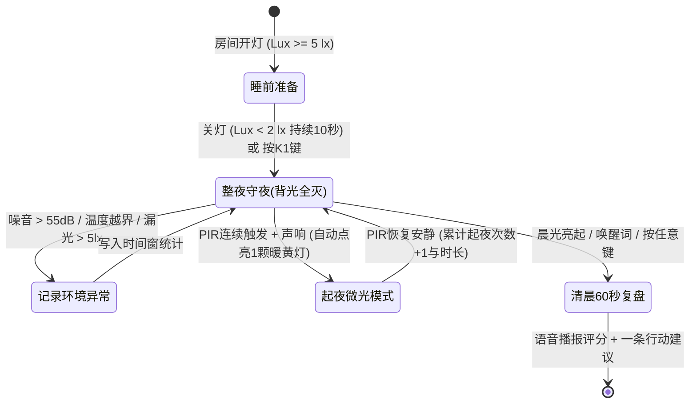
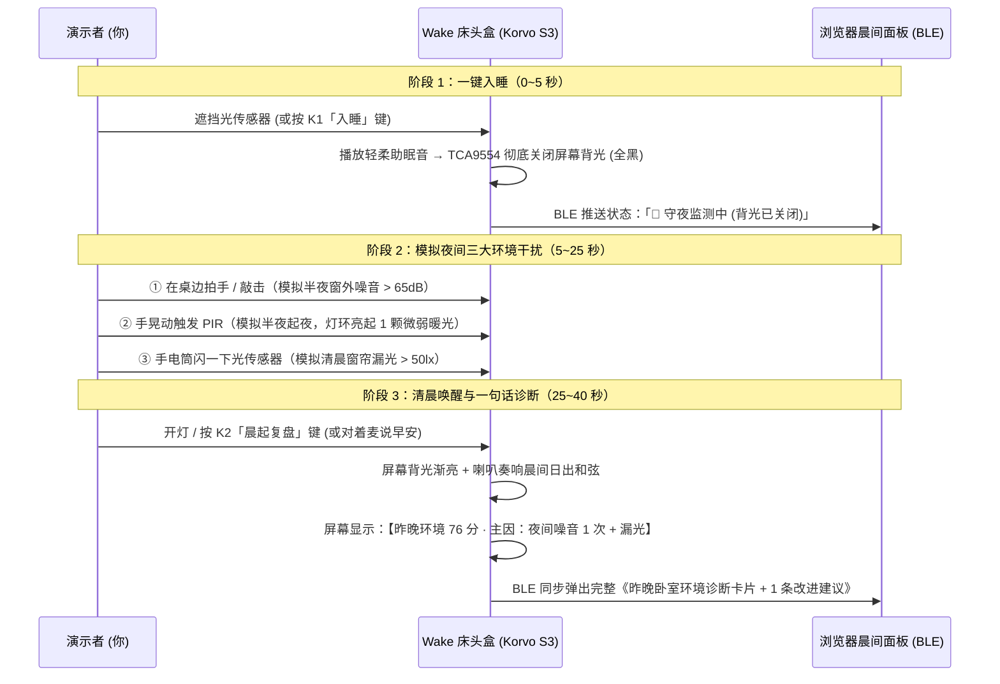

# 🌙 Wake 睡眠环境守夜盒 · 产品与技术落地规划

> **一句话定位**：Apple Watch / Oura 测的是你的身体，**Wake 守的是你的房间**——整夜零光污染被动监测卧室「光、温、噪、起夜」，早晨用一句话告诉你昨晚为什么没睡好。

---

## 一、 现有硬件盘点与四个传感器的产品落地点

结合已读完的 [Kevincoooool/esp-idf-docs](https://github.com/Kevincoooool/esp-idf-docs) 与 [酷世 DIY Korvo 2 V3 飞书硬件及小智 AI 资料](https://icnynnzcwou8.feishu.cn/wiki/ZfPywQKLgi8q3HkQzAjcVc5pnD3)，我们手头的 **ESP32-S3-Korvo-2 V3** 加上已调通的 **4 个传感器 + 板载执行器**，在「Wake 睡眠盒」中的落地点如下：

| 传感器 / 外设 | 硬件接口与状态 | 在「Wake 睡眠盒」中的核心落地点 | 采集指标与异常判定阈值 |
| :--- | :--- | :--- | :--- |
| **① SPA06 温度(气压)传感器** | `I2C 0x76`（外接已调通） | **夜间热舒适度监控** 追踪整夜室温漂移（如半夜空调定时关闭导致凌晨闷热醒、或凌晨寒潮过冷） | • 理想睡眠区：$18.0\sim22.5\,^\circ\text{C}$ • 异常事件：$>25\,^\circ\text{C}$（过热）或 $<16\,^\circ\text{C}$（过冷），记录持续分钟数与最低/最高温时点 *(注：SPA06 测温度+气压，不含湿度；气压变化可辅助判断门窗开合/强对流天气)* |
| **② BH1750 光照传感器** | `I2C 0x23`（外接已调通） | **暗度卫生（Darkness Hygiene）+ 自动熄屏触发器** 1. 关灯后自动切断开发板屏幕背光，实现「真·零光污染」 2. 捕捉夜间漏光（走廊灯、充电器指示灯、清晨窗帘漏光早醒） | • 入睡触发：$<2\,\text{lx}$ 持续 10 秒 → 自动进入守夜模式并硬切背光 • 异常光污染：守夜期间出现 $>5\,\text{lx}$ 脉冲或清晨过早 $>20\,\text{lx}$ |
| **③ AM412 PIR 人体红外** | `GPIO 19`（外接已调通） | **无感起夜次数与离床时长记录** 无需佩戴手环，被动记录夜间下床/起夜时间点、次数与每次持续时长 | • 轻微翻身：短促单次触发（$<15\,\text{s}$） • **起夜判定**：连续触发 $>30\,\text{s}$ 或伴随光照/声压上升 → 记为 1 次起夜并累计时长 |
| **④ 板载 ES7210 双麦克风** | `I2C 0x40 + I2S`（板载已调通） | **1. 夜间噪音冲击记录（只记分贝包络，不录人声）** **2. 早晨 60 秒语音唤醒与记梦对话入口** | • 理想底噪：$<40\,\text{dB}$ • 噪音冲击事件：峰值 $>55\,\text{dB}$（窗外鸣笛、空调异响、重度打鼾、关门声），记录发生时间与峰值分贝 |
| **配套板载执行器** | • `TCA9554 (0x38)` 背光开关 • `ES8311 + 3W 喇叭` • `GPIO 5` 六键 • `WS2812` 灯环 | • **TCA9554 P1**：硬件级彻底关闭 LCD 背光（全黑不刺眼） • **3W 喇叭**：睡前白噪音 / 晨间一句话语音复盘 • **WS2812 灯环**：起夜时自动亮 1 颗微弱琥珀色柔光，不破坏褪黑素 | 物理按键支持床头盲操（一键进入睡眠 / 早晨一键播报昨晚总结） |

---

## 二、 核心决策：是否值得开摄像头？

> [!IMPORTANT]
> **结论建议：坚决不开摄像头（并将「无镜头 / 物理拔除镜头」作为卧室产品核心信任卖点）。**

### 1. 为什么不值得开摄像头？（三大硬伤）
1. **光学物理限制（全黑环境下完全失效）**：
   Korvo 2 V3 标配的 DVP 摄像头（`OV2640` / `GC0308`）是普通可见光传感器，**没有 940nm 无红暴红外补光灯和 IR-Cut 滤光片**。在睡眠卫生要求的 `< 1 lx` 全黑卧室里，摄像头采集到的帧缓冲 100% 是纯黑噪点，无论是 `face_recognition` 还是移动侦测都无法在夜间工作。
2. **卧室隐私红线与心理排斥**：
   床头是用户最私密的空间。即使在技术上使用 `ESP-DL` 纯本地推理、不落盘不联网，只要床头有一个正对床铺的镜头，用户就会产生心理防御感，直接违背「放松助眠」的产品初衷。
3. **发热干扰温感 + 抢占内存与总线**：
   开启 DVP 持续取帧会让 ESP32-S3 功耗上升约 $350\sim500\,\text{mW}$，板载温升会通过热传导抬高附近 `SPA06` 的温度读数（导致室温虚高 $1.5\sim3\,^\circ\text{C}$）。

### 2. 若特殊场景一定要开：解决什么问题 & 隐私边界怎么定？
- **唯一可解决的问题**：仅在**清晨光线亮起后**，识别用户「已坐起 / 看向床头盒」，实现**免唤醒词（Look-to-Wake）**自动播报晨间简报。
- **必须死守的隐私边界**：
  1. **夜间硬件断电**：只要 `BH1750 < 5 lx`，立即拉高 `CAM_PIN_PWDN` 切断摄像头电源。
  2. **零落盘、零网络**：帧缓冲仅在 PSRAM 中驻留（`esp_camera_fb_get()` 检测完存在性后毫秒级 `esp_camera_fb_return()` 清零），绝不写入 NVS/TF 卡，Wi-Fi 栈在取帧期间禁止读取帧指针。
  3. **物理滑盖**：外壳（飞书资料中的 `Korvo上盖.stl`）必须配物理遮光拨片。

### 3. 不开摄像头，如何用现有 4 个传感器替代？
通过 **「BH1750 光照 + AM412 PIR + ES7210 声压包络」三元状态机**，完全可以零隐私风险地还原整夜睡眠环境与行为事件：

---

## 三、 优先级排期（今天能做 / 明天能做 / 可砍）

### 🟢 今天能做（Today · 2~3 小时内直接跑通上板的 MVP）
利用现有已调通的固件框架，不需要依赖外部云端服务即可完成完整闭环：
1. **真·零光污染「熄屏守夜模式」**：
   - 当 `BH1750` 检测到关灯（`< 2 lx`）或按下板载 `K1` 键，通过 `TCA9554` 寄存器 (`0x38` bit 1) **硬件级彻底关闭 LCD 背光**（屏幕全黑零发光）。
2. **整夜四大维度静默采集与异常归因引擎**：
   - 在内存中按时间轴统计：
     - **噪音冲击次数与最大分贝**（如：`凌晨 03:15 出现 64dB 突发噪音`）
     - **最低/最高温度与越界时长**（如：`后半夜室温降至 16.2°C 偏冷`）
     - **夜间漏光次数与时长**（如：`05:40 窗帘漏光达 45 lx`）
     - **PIR 起夜次数与总时长**（如：`起夜 1 次，耗时 3 分钟`，起夜时 WS2812 自动点亮 1 颗低亮度琥珀色柔光小夜灯）
3. **环境睡眠卫生评分（0~100 分）+ 规则生成的「早晨一句话建议」**：
   - 根据四项扣分因子自动找出**昨晚最大短板**（例如噪音扣分最多 → 建议检查窗户密封或耳塞；温度偏高 → 建议睡前定 21°C；清晨漏光 → 建议拉严遮光帘）。
4. **清晨唤醒与一键/声控复盘播报 + 蓝牙夜间报告看板**：
   - 早上开灯、拍手/说话唤醒、或按板载键时，自动点亮屏幕展示 **「昨晚环境评分 + 四维统计卡片」**，并通过 3W 喇叭播放唤醒和弦与语音/提示音，同时同步到浏览器 Web Bluetooth 晨间报告面板。

---

### 🟡 明天能做（Tomorrow · 进阶语音 AI 与穿戴设备互补）
基于飞书资料中的 **小智 AI (`xiaozhi-esp32 v2.2.6`)** 或 **ESP-SR 本地唤醒 + 云端 LLM + TTS**：
1. **本地唤醒词（"你好小智 / 小白小白"）+ 60 秒晨间自然语音对话**：
   - 将夜间采集到的结构化环境 JSON（`{"score":78, "noise_events":3, "max_db":66, "min_temp":16.4, "wake_ups":1}`）注入 LLM System Prompt。
   - 早晨唤醒后，盒子用自然人声主动说：*“早安！昨晚卧室整体 78 分，主要问题是凌晨三点半有两次超过 65 分贝的窗外噪音，另外五点半后窗帘漏光偏亮。今晚要不要试试睡前把内层窗帘拉紧？顺便问下，昨晚做梦了吗？”*
2. **睡前/醒后「语音记梦本」与睡前故事/白噪音流媒体**：
   - 醒来直接口述梦境，通过 ES7210 录音转文字归档；睡前语音点播雨声/篝火白噪音（定时 30 分钟渐弱关闭）。
3. **Apple Watch / Oura 睡眠数据交叉印证（Web 端）**：
   - 导入 Apple Health 的浅睡/清醒时间段，与 Wake 盒子的「噪音/温度/漏光时间轴」对齐，直接告诉用户：*“你凌晨 03:18 的清醒，正是因为当时房间出现了 64dB 的突发噪音”*。

---

### 🔴 可砍 / 明确不做（Cut · 保持产品锋利度）
1. **砍掉 DVP 摄像头视觉监测**：省去算力、发热与隐私顾虑。
2. **砍掉医疗级睡眠分期（REM/深睡诊断）**：不跟 Apple Watch 抢人体生理监测，坚守「只测房间环境」边界。
3. **砍掉手机 App 常驻配网与睡前刷手机操作**：所有睡前/起床操作均可通过 **关灯自动触发 / 板载物理按键 / 语音** 完成。
4. **暂不增加外接湿度传感器焊接**：当前用 SPA06 温度 + 气压即可跑通完整环境评分，后续只需在 I2C 口并联一颗 `SHT30 (0x44)` 即可补齐湿度。

---

## 四、 最小可演示路径（3 分钟快进式 Demo 剧本）

为了在演示时不需要真的等 8 小时，我们可以在固件与网页端做一个 **「🌙 30 秒夜间浓缩演示模式（Demo Night Mode）」**：

---

## 五、 待确认问题（Open Questions）

> [!NOTE]
> 请确认以下两个问题，确认后我即可开始为你编写代码或准备下一阶段实现：
> 1. **是否需要我现在把上述「30 秒浓缩守夜演示模式（含 TCA9554 真熄屏守夜 + 环境评分算法 + 早晨一句话诊断卡片）」直接写进当前开发板固件和蓝牙网页中？**
> 2. **你手头的四个外接传感器（PIR、BH1750、SPA06、WS2812 灯环）明天演示时会重新插回板子上吗？**（我们可以做到：插上时用真实外接传感器数据，未插时支持用板载麦克风+按键+模拟曲线完成同样丝滑的演示。）
